<div align="center">

# camera-noise-characterization

**Characterise a machine-vision camera like a metrologist - from photons to edges.**

Optics calculator · photon-transfer noise analysis · denoising and edge benchmarks ·
a physics-based sensor twin that validates every method against ground truth


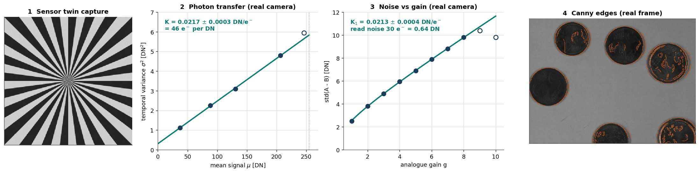

</div>

Most image-processing code treats the camera as a black box. This project opens it: it turns
two flat-field frames into the camera's **conversion gain, read noise and dynamic range**,
predicts **field of view, pixel footprint and depth of field** before you mount a lens, and
benchmarks **denoising and edge filters against closed-form theory** instead of eyeballing them.

Every analysis is first proven on a **digital twin** - an EMVA 1288 sensor model with known
parameters - and then applied to **real measurements from a Baumer TXG08 GigE camera**.

## Highlights

| | Result | Evidence |
| --- | --- | --- |
| Real camera | **Conversion gain 0.0217 ± 0.0003 DN/e⁻** from an exposure sweep and **0.0213 ± 0.0004 DN/e⁻** from an independent gain sweep - **2 % apart** | [photon transfer](#1-photon-transfer-on-the-real-camera) |
| Real camera | **Read noise 22-30 e⁻ (0.48-0.64 DN)** from the two fits, near the datasheet's "< 0.5 LSB typical" | both fits, R² ≥ 0.9995 |
| Sensor twin | Ground truth recovered to **0.02 %** (gain) and **0.2 %** (read noise) | [twin validation](#2-the-twin-proves-the-method) |
| Optics | 12 mm f/1.4 at 342 mm: **132 x 99 mm** field, **128 µm** per pixel, **10.2 mm** depth of field | [optics](#3-optics-before-the-lens-goes-on) |
| Filters | Binomial noise reduction matches `sqrt(sum w²)` to **3 decimals**; the 3x3 median loses 8 % on 8-bit data | [denoising](#5-denoising-theory-vs-measurement) |
| Edges | At contrast-to-noise 2, **Canny σ = 2.5 keeps F1 = 0.95** while thresholded Sobel drops to 0.66 | [edges](#6-edge-detectors-with-exact-ground-truth) |

## How it fits together

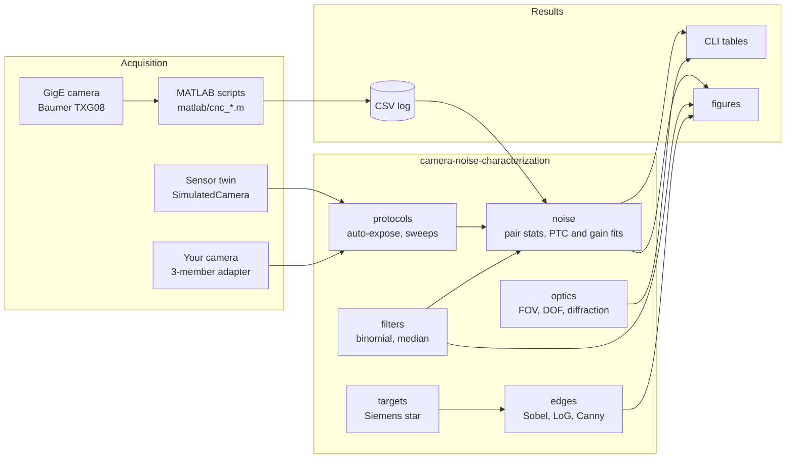

The **signal chain** the twin simulates - and the noise sources the analysis separates again:

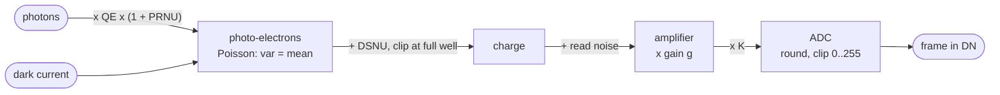

The **gain-sweep protocol** - the lab procedure, automated:

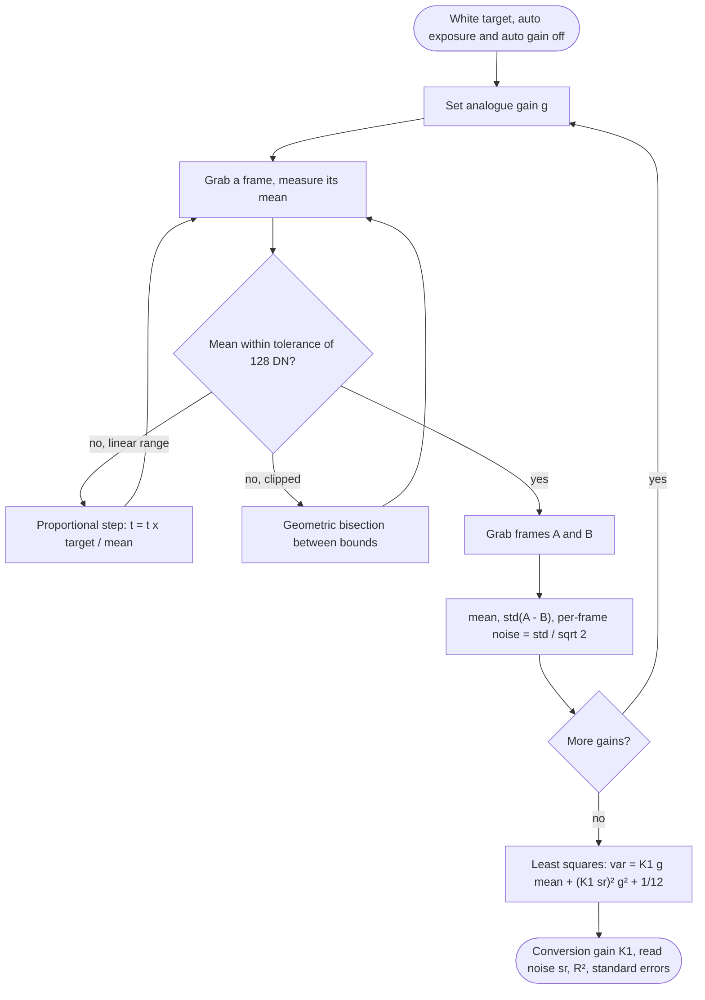

The **public API** - any object with `exposure_us`, `gain` and `grab()` can be measured:

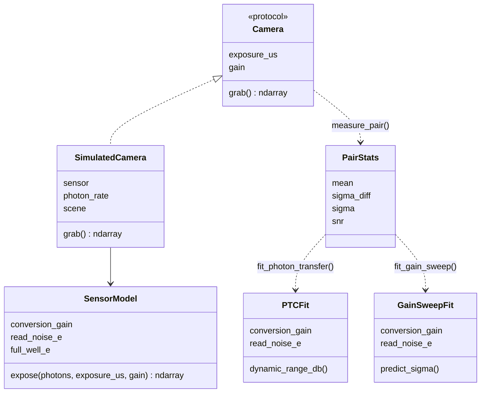

## Quick start

From the repository root:

```bash
pip install -e ".[dev]"     # numpy, scipy, pillow (+ matplotlib, pytest, ruff)
pytest                      # 47 tests, a few seconds
```

```bash
camera-noise-characterization optics --focal 12 --f-number 1.4 --distance 342   # field calculator
camera-noise-characterization fit data/lab_gain_sweep.csv                        # real camera data
camera-noise-characterization simulate ptc --out ptc.csv && camera-noise-characterization fit ptc.csv
camera-noise-characterization pair flat_a.tif flat_b.tif                         # your own frames
camera-noise-characterization denoise flat_a.tif flat_b.tif
camera-noise-characterization edges data/coins_txg08.png --method canny --sigma 2 --non-edge-fraction 0.9 --out edges.png
```

```text
$ camera-noise-characterization fit data/lab_gain_sweep.csv
quantity                    value
--------------------------  --------------------------------------
model                       var = K1 g mean + (K1 sr)^2 g^2 + 1/12
points used                 8
conversion gain K1 [DN/e-]  0.0213 +- 0.0004
electrons per DN at gain 1  47.0
read noise [e-]             29.9
read noise at gain 1 [DN]   0.64
R^2                         0.9999
```

From Python:

```python
from camera_noise_characterization import SimulatedCamera, fit_photon_transfer
from camera_noise_characterization.protocols import photon_transfer_sweep

cam = SimulatedCamera(seed=0)  # or your own camera adapter
points = photon_transfer_sweep(cam, n_points=24, black_level=cam.sensor.black_level_dn)
fit = fit_photon_transfer(
    [p.stats.mean for p in points], [p.stats.variance for p in points], max_mean=230
)
print(f"K = {fit.conversion_gain:.4f} DN/e-, read noise = {fit.read_noise_e:.1f} e-")
# K = 0.0220 DN/e-, read noise = 29.1 e-
```

## Results

### 1. Photon transfer on the real camera

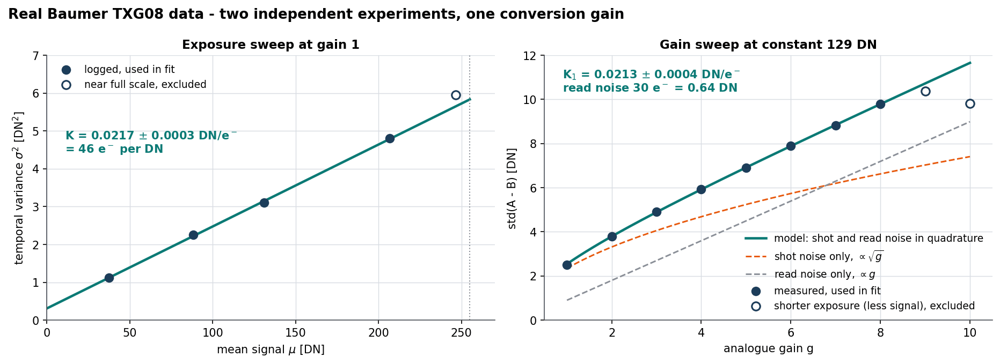

Two experiments, run for different purposes, measure the same physical constant:

- **Left - exposure sweep.** Photo-electrons are Poisson distributed, so the temporal variance
  grows linearly with the signal and the slope is the conversion gain `K`. Four unsaturated
  points give **K = 0.0217 ± 0.0003 DN/e⁻ (46 e⁻ per DN)**, R² = 0.9995.
- **Right - gain sweep at a constant 129 DN.** Shot noise grows like √g, read noise injected
  before the amplifier grows like g. Fitting both terms gives **K₁ = 0.0213 ± 0.0004 DN/e⁻** and
  **≈ 30 e⁻ read noise**; the two contributions cross at g ≈ 6.8. Gains 9 and 10 were logged
  with a shorter exposure (less signal) and are shown but not fitted.

The full scale of the 8-bit output therefore holds about **12 000 electrons** at gain 1, and the
0.48-0.64 DN read noise of the two fits sits near the datasheet's "< 0.5 LSB" (specified for the
slower, low-noise readout mode). The data, their provenance (logged vs. digitised from the lab
plots) and every exclusion are documented in [`data/README.md`](data/README.md).

> **Lesson learned.** One single-pair measurement in the original lab log
> (`std(A - B) = 1.65 DN` at a nominal 128 DN) sits about a third below the photon-transfer
> prediction of 2.5 DN. The log cannot tell whether the mean, the settings or the frames were
> off - which is exactly why `camera-noise-characterization` records every value it fits.

### 2. The twin proves the method

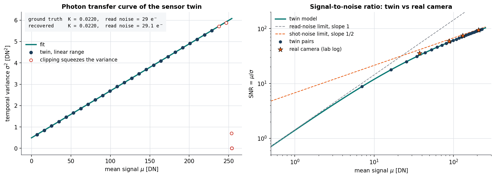

A 36-point photon-transfer sweep of the twin (1032 x 776 pixels, the real sensor format)
recovers the configured gain to **0.02 %** and the read noise to **0.2 %**, and shows the
variance collapse once pixels clip. On the right, the twin - parameterised with the fits above -
reproduces the real camera's SNR (stars) across the whole range: read-noise-limited (slope 1)
below ≈ 20 DN, shot-noise-limited (slope ½) above.

### 3. Optics before the lens goes on

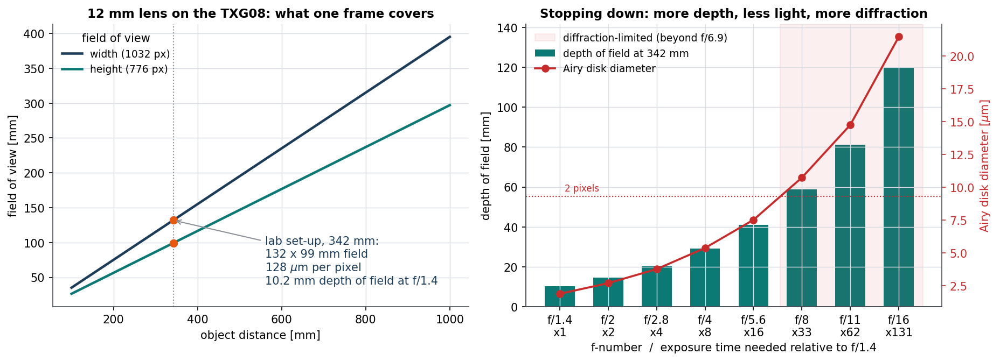

| Baumer TXG08 + 12 mm, f/1.4, object at 342 mm | Value |
| --- | --- |
| sensor | 1032 x 776 px, 4.65 µm, 4.80 x 3.61 mm |
| magnification | 1 : 27.5 |
| field of view (thin lens / pinhole shortcut) | 131.97 x 99.23 mm / 136.77 x 102.84 mm |
| angle of view (h x v x diagonal) | 22.62° x 17.10° x 28.09° |
| object-plane pixel | 0.128 mm |
| depth of field (circle of confusion = 1 pixel) | 336.97 - 347.18 mm = 10.2 mm |
| hyperfocal distance | 22.1 m |
| diffraction-limited beyond | f/6.9 (Airy disk > 2 pixels) |

Stopping down from f/1.4 to f/8 buys 6x the depth of field but costs 33x the exposure time -
and beyond f/6.9 diffraction, not the pixel grid, limits sharpness.

### 4. Exposure vs gain

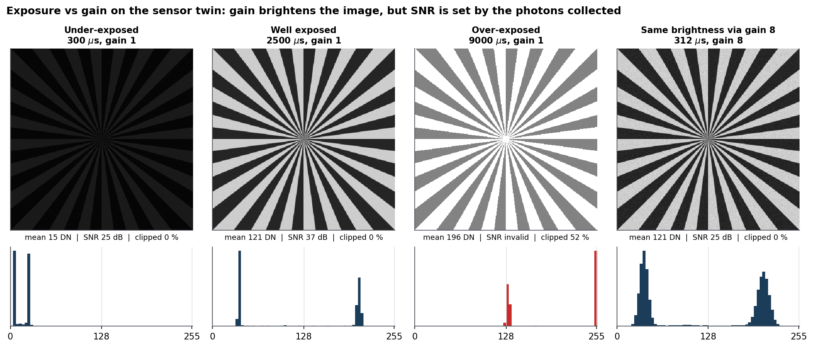

Gain 8 brings an under-exposed frame back to the same brightness as a proper exposure - but its
SNR stays at 25 dB instead of 37 dB, because SNR is fixed by the photons collected. Gain is a
display convenience, not free signal.

### 5. Denoising: theory vs measurement

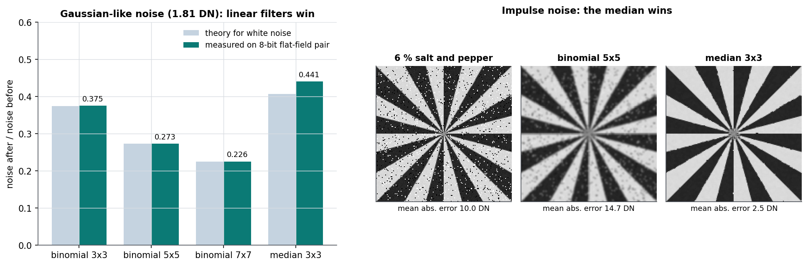

| Filter (8-bit flat-field pair, 1.81 DN noise) | Theory for white noise | Measured |
| --- | --- | --- |
| binomial 3x3 | 0.375 | 0.375 |
| binomial 5x5 | 0.273 | 0.273 |
| binomial 7x7 | 0.226 | 0.226 |
| median 3x3 | 0.407 | 0.441 |

Linear filters behave exactly as `sqrt(sum w²)` predicts. The median is weaker on Gaussian-like
noise - and its integer output keeps the quantisation noise - but it is the only one that removes
salt-and-pepper outliers (mean absolute error 2.5 DN vs 14.7 DN for binomial 5x5).

### 6. Edge detectors with exact ground truth

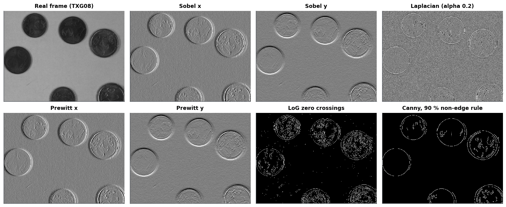

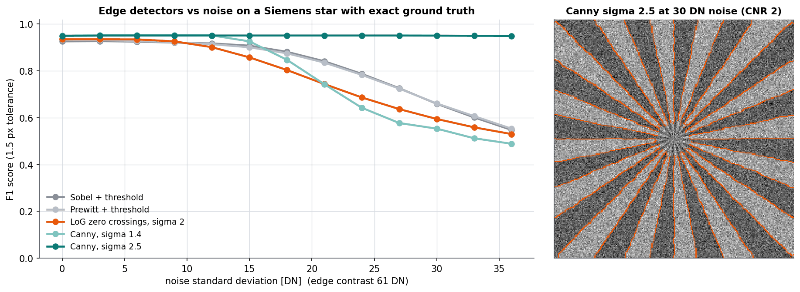

All operators are implemented from scratch (Canny included: non-maximum suppression and
hysteresis via connected components). On an anti-aliased Siemens star with pixel-exact ground
truth, the **smoothing scale decides robustness**: at a contrast-to-noise ratio of 2, Canny with
σ = 2.5 keeps **F1 = 0.95**, thresholded Sobel reaches 0.66, LoG 0.59 and Canny with σ = 1.4 only
0.55.

## Bring your own camera

The protocols only need three members, so any SDK (GenICam/Harvesters, pypylon, Vimba,
OpenCV, ...) plugs in with a thin adapter:

```python
from camera_noise_characterization.noise import fit_gain_sweep
from camera_noise_characterization.protocols import gain_sweep


class MyCamera:
    def __init__(self, device):
        self.device = device
        self.exposure_us = 1000.0
        self.gain = 1.0

    def grab(self):
        self.device.configure(exposure_us=self.exposure_us, gain=self.gain)  # your SDK calls
        return self.device.capture()  # 2-D numpy array


points = gain_sweep(MyCamera(device), gains=range(1, 9), target_mean=128)
fit = fit_gain_sweep(
    [p.gain for p in points], [p.stats.mean for p in points], [p.stats.variance for p in points]
)
```

The original hardware sessions used MATLAB; the cleaned-up acquisition scripts in
[`matlab/`](matlab/README.md) write CSV files that `camera-noise-characterization fit` reads directly.

## Repository layout

```text
camera-noise-characterization/
├── src/camera_noise_characterization/
│   ├── optics.py        thin-lens field of view, pixel footprint, depth of field, diffraction
│   ├── sensor.py        EMVA 1288 sensor twin and SimulatedCamera
│   ├── noise.py         pair statistics, photon-transfer and gain-sweep fits
│   ├── protocols.py     auto-exposure, exposure / gain / photon-transfer sweeps
│   ├── filters.py       binomial, box and median filters, benchmark against theory
│   ├── edges.py         Sobel, Prewitt, Laplacian, LoG, Canny, F1 scoring
│   ├── targets.py       Siemens star with exact edge ground truth
│   ├── io.py            grayscale image I/O
│   └── cli.py           the `camera-noise-characterization` command
├── tests/               47 tests: physics, fits, protocols, filters, edges, CLI
├── examples/            reproduce_figures.py regenerates every figure in docs/figures
├── data/                real lab measurements and one camera frame (provenance in data/README.md)
├── docs/                theory notes and figures
├── matlab/              acquisition scripts used on the hardware
└── .github/workflows/   CI: ruff, pytest on Python 3.10-3.13, figure smoke test
```

## Reproduce everything

```bash
python examples/reproduce_figures.py      # writes docs/figures/*.png
```

The derivations behind every formula are in [`docs/theory.md`](docs/theory.md).

## Limitations and next steps

- The real-camera fits rest on hand-logged and digitised values; a fresh automated sweep with
  the MATLAB scripts would remove that uncertainty.
- Quantum efficiency needs a calibrated light source and is therefore an assumed twin parameter;
  every result above is expressed in DN and electrons, which do not depend on it.
- Spatial non-uniformity (PRNU/DSNU maps) and dark-current temperature series are simulated but
  not yet analysed on real frames.

## Part of a series

This is part 1 of a three-part classical computer-vision series built from hands-on lab work:

1. **camera-noise-characterization** - the camera as a measuring instrument (this repository)
2. **featureforge** - blobs, lines and corners with built-in evidence: sensitivity sweeps and
   geometric cross-checks
3. **stereometry** - calibrated stereo depth with an explicit error budget

## License

[MIT](LICENSE)
